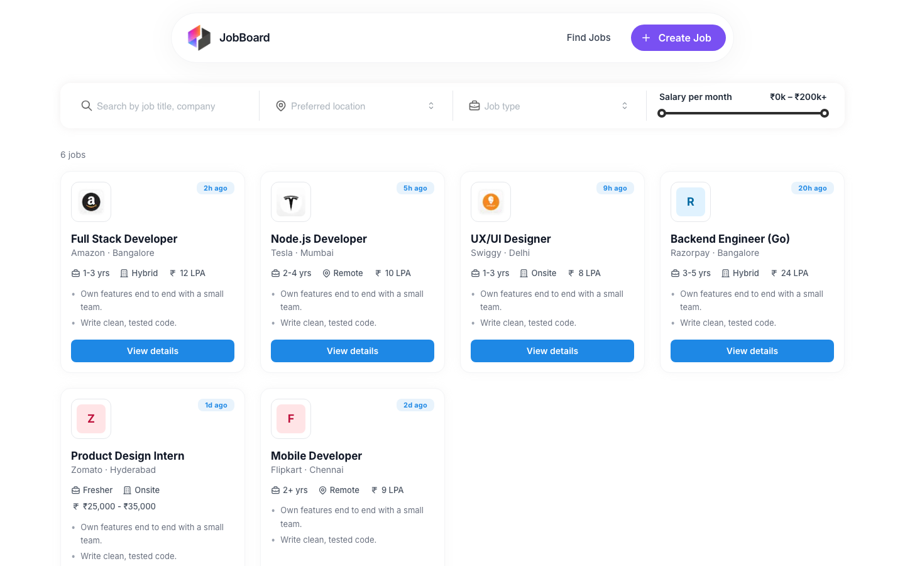
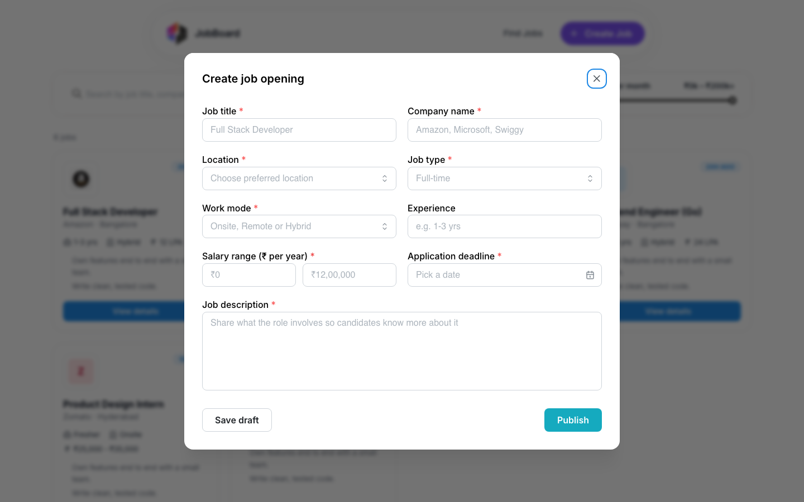
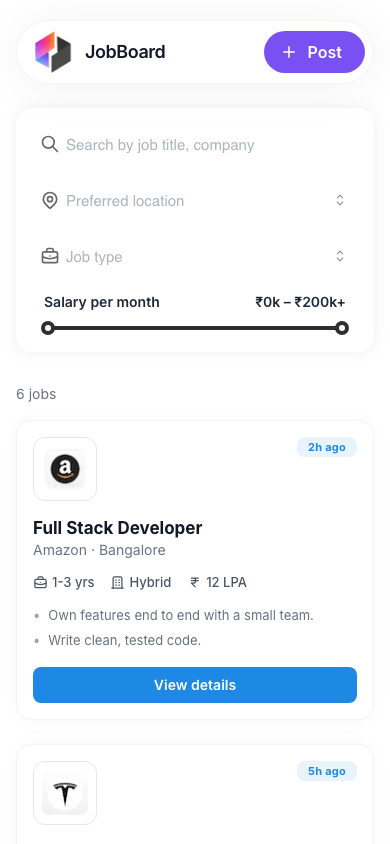

# Job Management Admin Interface

A full-stack job board admin built with Next.js 14, Mantine and a NestJS + TypeORM + PostgreSQL REST API. You can browse, filter, create, edit and delete job postings.


[](https://github.com/VamsiKrishnaThota03/job-management/actions/workflows/ci.yml)
[](https://github.com/VamsiKrishnaThota03/job-management/actions/workflows/codeql.yml)
[](LICENSE)

## Live demo

<https://job-management-orpin.vercel.app>

| Job board | Create job | Mobile |
| --- | --- | --- |
|  |  |  |

> **The hosted demo is read-only.** Writes now fail closed (see
> [Write access](#write-access)), and the bundled frontend has no key to send —
> by design, since a `NEXT_PUBLIC_*` value is shipped to every browser and so is
> not a credential. Run it locally to create and edit jobs.

## Overview

- **`frontend/`**: a Next.js (App Router) app styled with Mantine and Tailwind. It shows job cards with search, location, job type and salary filters, and has a modal form for posting a job.
- **`backend/`**: a NestJS API with one `jobs` resource, stored in PostgreSQL through TypeORM and validated with `class-validator`.

## Features

- **Job listing** sorted by newest first, with a responsive grid (1-4 columns) and "posted 3h ago" badges. If the API cannot be reached, labelled sample listings are shown with a retry button.
- **Filters**, applied on the client:
  - Text search on title or company
  - Preferred location
  - Job type
  - Monthly salary range slider (understands "12 LPA" and monthly or annual ₹ ranges)
- **Job details** modal with salary, deadline and full description, plus **Edit** and **Delete** (with confirmation)
- **Create job** modal (`/?create=true`) with inline validation, an annual salary range, a date picker and **Save draft** (kept in `localStorage`)
- **Edit job** page at `/jobs/[id]/edit`, loaded from and saved to the API
- **Validated REST API**: the global `ValidationPipe` uses `whitelist` and `forbidNonWhitelisted`; DTOs restrict `jobType` (`Full-time`, `Part-time`, `Contract`, `Internship`) and `workMode` (`Onsite`, `Remote`, `Hybrid`) and cap field lengths
- **Optional write protection:** set `ADMIN_API_KEY` on the API to require an `x-admin-key` header for POST/PATCH/DELETE
- **CORS** limited to the origins in `FRONTEND_URL`; `GET /` is a health check
- **Tests:** backend unit tests plus e2e tests that run the real controllers and validation against an in-memory repository (no database needed)
- **Deploy configs**: `backend/render.yaml` for Render. The frontend is hosted on Vercel.

## Tech stack

| Layer    | Technology                                                                  |
|----------|-----------------------------------------------------------------------------|
| Frontend | Next.js 14, React 18, TypeScript, Mantine 7 (core, dates, notifications), Tailwind CSS 3, Tabler icons |
| Backend  | NestJS 10, TypeORM 0.3, `pg`, class-validator / class-transformer, `@nestjs/config` |
| Database | PostgreSQL (Neon in production). TLS with certificate verification by default. |

## Project structure

```
.
├── backend/
│   ├── src/
│   │   ├── main.ts                # Bootstrap, CORS, global ValidationPipe
│   │   ├── app.module.ts          # TypeORM (Postgres) + JobsModule + health route
│   │   ├── config/                # DATABASE_URL / TLS / CORS settings
│   │   ├── common/                # AdminKeyGuard (optional ADMIN_API_KEY)
│   │   └── jobs/
│   │       ├── jobs.controller.ts # /jobs routes
│   │       ├── jobs.service.ts
│   │       ├── entities/job.entity.ts
│   │       └── dto/               # CreateJobDto, UpdateJobDto
│   ├── test/                      # e2e tests + in-memory repository
│   └── render.yaml
└── frontend/
    ├── src/
    │   ├── app/
    │   │   ├── page.tsx           # Job board + filters
    │   │   └── jobs/              # create (modal) and [id]/edit pages
    │   ├── components/            # Header, SearchFilters, JobCard, JobDetailsModal, CreateJobModal, JobForm, CompanyLogo
    │   ├── lib/                   # salary parsing, date helpers, offline sample jobs
    │   ├── services/api.ts        # fetch wrapper for the jobs API
    │   ├── providers/MantineProvider.tsx
    │   └── types/job.ts
    └── public/images/             # Logos used on job cards
```

## Getting started

### Prerequisites

- Node.js 20+ (the backend's TypeORM version needs the global `crypto`) and npm
- PostgreSQL, local or hosted (for example Neon)

### 1. Clone

```bash
git clone https://github.com/VamsiKrishnaThota03/job-management.git
cd job-management
```

### 2. Backend

```bash
cd backend
npm install
```

Copy `backend/.env.example` to `backend/.env`. The API exits at startup if `DATABASE_URL` is missing.

| Variable         | Required | Description |
|------------------|----------|-------------|
| `DATABASE_URL`   | Yes | PostgreSQL connection string, e.g. `postgresql://<user>:<password>@<host>/<db>?sslmode=require` |
| `PORT`           | No  | API port (default `3001`) |
| `FRONTEND_URL`   | No  | Allowed CORS origin(s), comma-separated (default `http://localhost:3000`) |
| `DB_SSL`         | No  | Unset: verified TLS (no TLS for `localhost`). `no-verify`: TLS without certificate checks. `disable`: no TLS. |
| `DB_SYNCHRONIZE` | No  | `true` (default) lets TypeORM create/alter the `job` table from the entity; set `false` once you manage the schema yourself |
| `ADMIN_API_KEY`  | No  | When set, POST/PATCH/DELETE require the header `x-admin-key: <value>`. The bundled frontend does not send it, so use this to make a deployed API read-only. |

```bash
npm run start:dev      # watch mode
# or
npm run build && npm run start:prod
npm test && npm run test:e2e   # unit + e2e tests (no database needed)
```

### 3. Frontend

```bash
cd ../frontend
npm install
```

Copy `frontend/.env.example` to `frontend/.env.local`:

| Variable              | Description           | Example                  |
|-----------------------|-----------------------|--------------------------|
| `NEXT_PUBLIC_API_URL` | Backend base URL      | `http://localhost:3001`  |

```bash
npm run dev
```

- Frontend: <http://localhost:3000>
- Backend API: <http://localhost:3001>

### Other scripts

| Location  | Command           | Purpose                    |
|-----------|-------------------|----------------------------|
| backend   | `npm run lint`    | ESLint (with `--fix`)      |
| backend   | `npm run format`  | Prettier                   |
| backend   | `npm test`        | 15 Jest unit tests         |
| backend   | `npm run test:e2e`| 10 API e2e tests (in-memory repository) |
| backend   | `npm run test:cov`| Unit tests with coverage   |
| root      | `npm run dev:backend` / `npm run dev:frontend` | Start either app from the repo root |
| frontend  | `npm run build`   | Production build           |
| frontend  | `npm run lint`    | `next lint`                |

## Write access

`GET /jobs` is public. Every write is guarded, and the guard **fails closed**:

| Server configuration | POST / PATCH / DELETE `/jobs` |
| --- | --- |
| `ADMIN_API_KEY=<secret>` | Require `x-admin-key: <secret>`; wrong or missing key gives **401** |
| `ALLOW_PUBLIC_WRITES=true` | Open to anyone (explicit opt-in, logged loudly at startup) |
| neither | **503**, naming `ADMIN_API_KEY` as the setting to fix |

This replaced a guard that returned `true` whenever `ADMIN_API_KEY` was unset:

```ts
const expected = process.env.ADMIN_API_KEY;
if (!expected) return true;   // <- writes open to anyone
```

Unset was the default, and the deployed instance ran that way, so `POST`,
`PATCH` and `DELETE /jobs` were accepting requests from anyone who found the
URL. Note the key comparison is timing-safe (`timingSafeEqual`, with a length
check first because it throws on a length mismatch) — that part was already
right; the problem was the branch that skipped it entirely.

`ALLOW_PUBLIC_WRITES` exists because a publicly writable demo is a reasonable
thing to want for a portfolio piece. The difference is that it is now a
decision someone typed, under a name that says what it does, rather than the
silent default — and the startup log states which mode is active, so a
misconfigured deploy is visible rather than discovered.

Both are deliberately strict: only the exact string `true` enables public
writes (`1`, `yes` and `TRUE` do not), and an empty `ADMIN_API_KEY` counts as
*unset* rather than as "a configured empty key" that an empty header would
match.

Ten e2e tests and a dedicated CI job pin this down, the CI job by booting the
real server against Postgres and checking an anonymous `POST` gets 503 while
`GET` still works.

## API

| Method | Path         | Purpose                                                       |
|--------|--------------|---------------------------------------------------------------|
| GET    | `/`          | Health check (`{"status":"ok"}`)                              |
| GET    | `/jobs`      | List all jobs (newest first)                                  |
| GET    | `/jobs/:id`  | Get one job (`404` if not found)                              |
| POST   | `/jobs`      | Create a job                                                  |
| PATCH  | `/jobs/:id`  | Update a job (partial)                                        |
| DELETE | `/jobs/:id`  | Delete a job (`204`)                                          |

Job payload:

```json
{
  "title": "Full Stack Developer",
  "companyName": "Acme",
  "location": "Bangalore",
  "jobType": "Full-time",
  "workMode": "Onsite",
  "experience": "1-3 yr",
  "salary": "12 LPA",
  "salaryRange": "₹6,00,000 - ₹12,00,000",
  "description": "Build and maintain web applications.",
  "applicationDeadline": "2030-12-31"
}
```

`experience` and `salary` are optional. All other fields are required.

## Docker

```bash
printf 'POSTGRES_PASSWORD=%s\nADMIN_API_KEY=%s\n' \
  "$(openssl rand -hex 16)" "$(openssl rand -hex 24)" > .env

docker compose up --build
open http://localhost:3001/api-docs
```

Postgres and the API both publish to `127.0.0.1` only, so neither is reachable
from your network. Compose fails fast with a named error if either variable is
missing. The image is multi-stage, runs as the unprivileged `node` user and
carries no dev dependencies.

## Continuous integration

| Job | What it proves |
| --- | --- |
| `backend` (Node 20, 22) | ESLint read-only (the repo's own `lint` script passes `--fix`, which would rewrite files in CI and still pass), Prettier, 15 unit tests, 10 e2e tests, coverage, and `nest build` |
| `write-access-guard` | Boots the real server against Postgres 16: with nothing configured reads work and an anonymous `POST`/`DELETE` returns 503; with `ADMIN_API_KEY` set, a missing and a wrong key both give 401 and the right key gives 201; Swagger UI is served |
| `frontend` | `next lint` and a production build |
| `docker` | The image builds and refuses to start without `DATABASE_URL` |

CodeQL runs weekly and on every push; Dependabot groups weekly patch/minor
bumps per package.

## API documentation

Swagger UI is served at `/api-docs`, with the `x-admin-key` scheme wired into
the **Authorize** button so writes can be tried from the browser.

## Known limitations

- There is no candidate side: "View details" shows the job, but there is no application flow.
- The API has no user accounts — `ADMIN_API_KEY` is a single shared secret, not per-user auth. It is enough to keep the deployed instance from being edited by strangers, but a real multi-user admin would need accounts and roles.
- The bundled frontend cannot send the admin key, so the hosted demo is read-only. Putting it in a `NEXT_PUBLIC_*` variable would ship it to every visitor's browser, which is not a credential; doing this properly means a server-side route handler holding the key, or real user accounts.
- Rate limit counters are in process memory, so the 600-per-15-minutes ceiling is per instance.
- `DB_SYNCHRONIZE` defaults to `true`, so TypeORM alters tables to match the entity on boot. Convenient for a demo; a service with real data wants migrations instead.
- Filtering and search run in the browser over all jobs; there is no server-side pagination.
- Locations come from a fixed list in `frontend/src/types/job.ts`.
